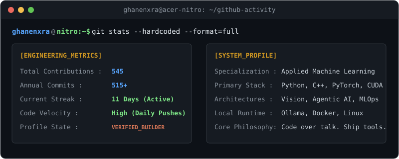

  <!-- Dynamic Typing Header -->
  

  

    <strong>Machine Learning Engineer</strong>
     
    Let's build something cool.
  

  <!-- Social Badges -->
  

    
    
    
    
  

---

### Tech Stack & Arsenal

<h4 align="center">Languages</h4>

  

<h4 align="center">Frameworks & Machine Learning</h4>

  

<h4 align="center">Tools & Platforms</h4>

  
  

---

### Now Playing

  

---

### Activity & Terminal Metrics

  

---

  Engineered by Ghanendra Chakradhari

